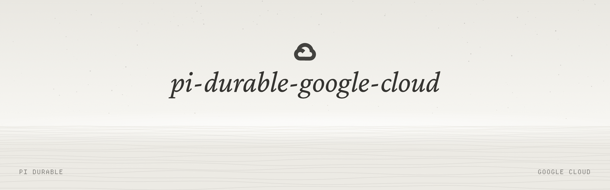

  <picture>
    <source media="(prefers-color-scheme: dark)" srcset=".github/assets/banner-dark.png">
    
  </picture>

  <em>pi-durable on Google Cloud: one GKE pod owns each session</em>

  <a href="https://earendil.com/posts/pi-durable/">Pi Durable</a>
  &nbsp;·&nbsp;
  <a href="https://cloud.google.com">Google Cloud</a>
  &nbsp;·&nbsp;
  <a href="LICENSE">MIT License</a>

 

## About

[Pi Durable](https://www.npmjs.com/package/@earendil-works/pi-durable) is a durable agent harness from [Earendil](https://earendil.com). It commits conversations, model turns, and tool calls to storage before anything is shown, so an agent picks up where it stopped after a crash or a restart.

This repository runs Pi Durable on [Google Cloud](https://cloud.google.com).

## Architecture

<!-- Diagram goes here. -->

## Further reading

- [Pi Durable announcement](https://earendil.com/posts/pi-durable/)
- [pi-durable package documentation](https://github.com/earendil-works/pi/tree/main/packages/durable)

## License

[MIT](LICENSE) © 2026 Pau Aran
