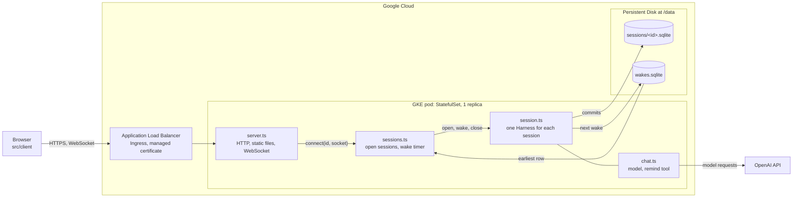

# pi-durable on Google Cloud

A working example of [`@earendil-works/pi-durable`](https://www.npmjs.com/package/@earendil-works/pi-durable) running on Google Cloud.

Start with the [Pi Durable announcement](https://earendil.com/posts/pi-durable/) for the ideas behind the harness. This repository shows one way to run those ideas on Google Cloud.

Pi Durable is experimental, so its APIs may still change.

## What you can try

- Create a chat session and open its URL in more than one browser.
- Close the browser, or restart the server, and come back to the same transcript.
- Send a prompt while an answer is running. It waits its turn.
- Ask for a reminder ("remind me in two minutes to stretch"). It is delivered even if the server restarted in between.

This is a sample, not a production service. It has no authentication and no rate limiting.

## Run it locally

You need Node.js 22.19 or newer, pnpm 11, and an OpenAI API key. You do not need a Google Cloud account.

```sh
pnpm install
cp .env.example .env
```

Add your key to `.env`:

```dotenv
OPENAI_API_KEY=your-key
```

Then build the client and start the server:

```sh
pnpm build
pnpm start
```

Open <http://localhost:8080>, create a session, and send a message. Session data goes to `./data`.

To work on the client, keep `pnpm start` running and run `pnpm dev` beside it. Vite serves the page and proxies `/api` to the server.

## Architecture

pi-durable needs one writer for each storage. On Google Cloud, a StatefulSet with one replica gives that: one pod, one Persistent Disk, and one SQLite file for each session.



**A session.** `POST /api/sessions` returns a new UUID. The browser then opens a WebSocket on `/api/sessions/<uuid>`. The server opens the session's SQLite file with a pi-durable Harness, sends the conversation as one `view` frame, and after each commit sends the changes as `ops` frames to every socket of that session. The browser sends `prompt` frames. Each prompt has a request ID, so a prompt that is sent again after a reconnect is stored once.

**Waking up.** The Harness keeps no timer for sleeping tasks. It tells the session when it must run next, and the session writes that time to `wakes.sqlite`. One timer in the pod waits for the earliest row and opens the session if it is closed. While work runs, the row stays at most 60 seconds ahead. After a crash, the new pod finds the row and continues the work.

**Closing.** A session with no socket and no running work closes and frees its memory. Its wake row stays, so a reminder that is due next week still opens it. On `SIGTERM` the server closes every session cleanly; pi-durable then sends an interrupted model request again and counts no crash.

**Limits.** The disk is in one zone, and the application is down while that zone or the pod is down. SQLite runs with `synchronous = NORMAL`: a commit survives a process crash, but a node failure can lose the newest commits. Do not raise `replicas` and do not force-delete the pod; both can put two writers on one session file.

## Where to look

- [`src/chat.ts`](src/chat.ts) defines the model, the system prompt, and the `remind` tool. It knows nothing about the host.
- [`src/session.ts`](src/session.ts) hosts one Harness on SQLite storage and connects it to its sockets and its wake row.
- [`src/sessions.ts`](src/sessions.ts) keeps the open sessions, the wake index, and the timer.
- [`src/server.ts`](src/server.ts) has the routes, the WebSocket upgrade, static files, and shutdown.
- [`src/protocol.ts`](src/protocol.ts) is the contract between browser and server.
- [`src/client/`](src/client/) is the browser client in plain TypeScript. It applies the operations to its copy of the view and renders it.
- [`test/`](test/) covers prompts, reconnects, wakes, recovery after a lost process, and the routes. The tests run on a temporary directory with a fake model.

## Commands

```sh
pnpm start      # run the server on port 8080
pnpm dev        # Vite dev server for the client
pnpm test       # test suite
pnpm check      # types, tests, and build
pnpm build      # production build of the client
```

## Deploy

[`deploy.yaml`](deploy.yaml) holds every Kubernetes object. You change two values in it, the image and the domain, both marked `# EDIT`. [`DEPLOY.md`](DEPLOY.md) has the steps: create a GKE Autopilot cluster, build the image, create the Secret with the API key, apply the manifest, and point your DNS record at the load balancer.

Before you expose a deployment, add authentication, authorization, and rate limiting. Anyone who can reach this sample can create sessions that use your model key.

## Further reading

- [Pi Durable announcement](https://earendil.com/posts/pi-durable/)
- [pi-durable package documentation](https://github.com/earendil-works/pi/tree/main/packages/durable)
- [pi-durable examples](https://github.com/earendil-works/pi/tree/main/packages/durable/test/examples)
- [Google Cloud documentation](https://cloud.google.com/docs)

## License

MIT
